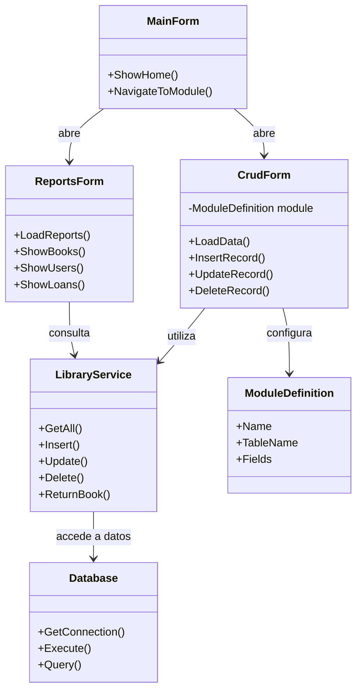
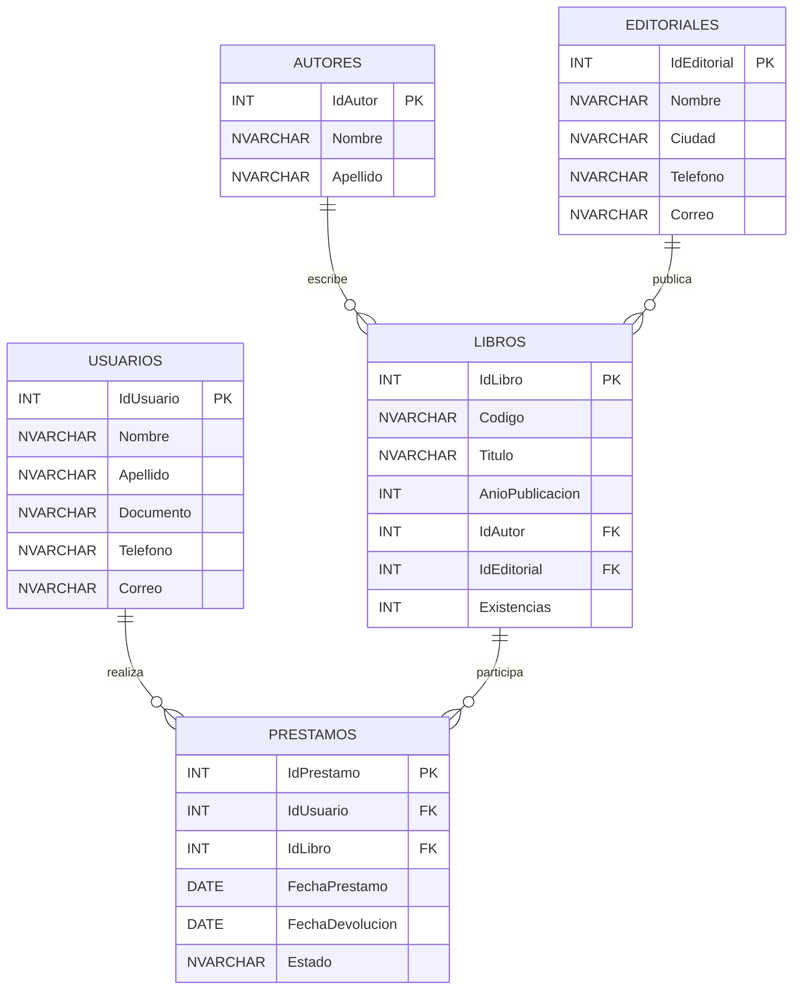
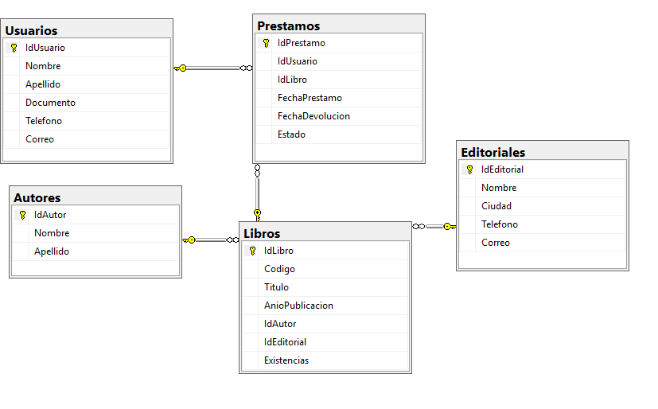
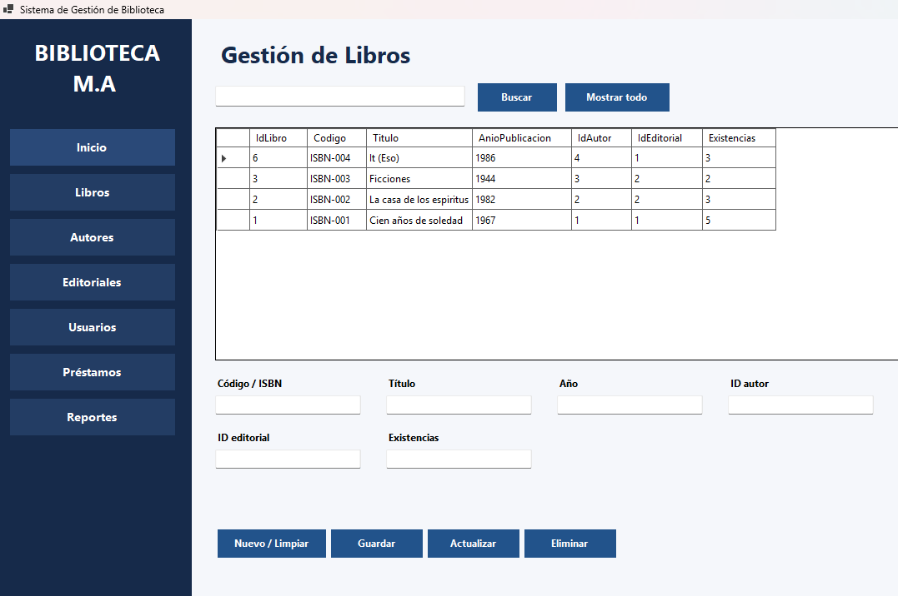
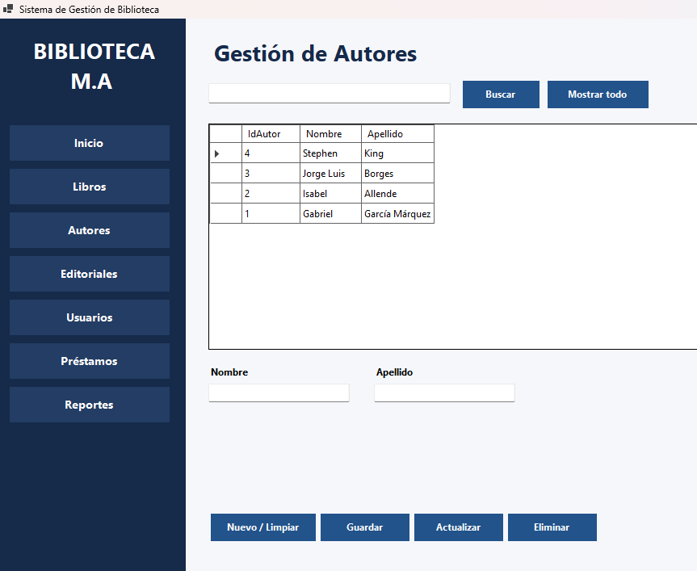
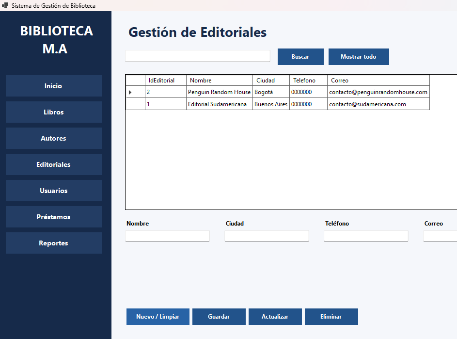
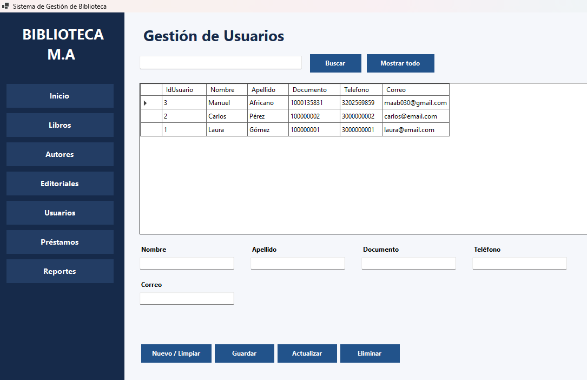
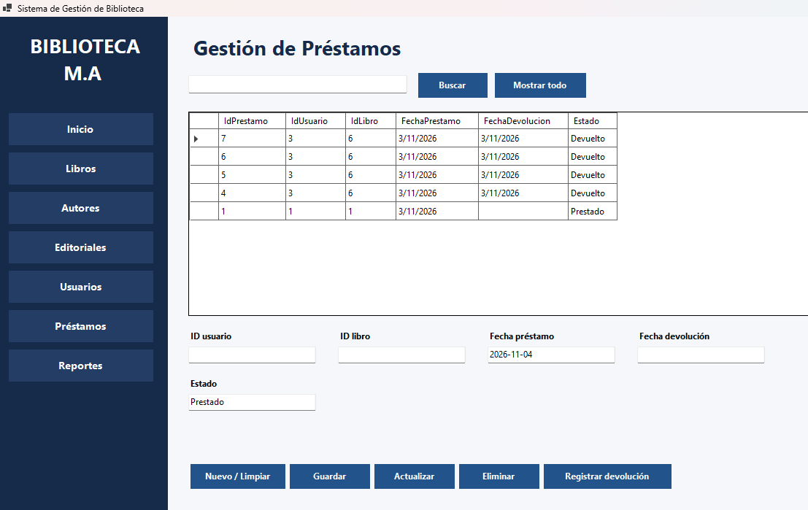
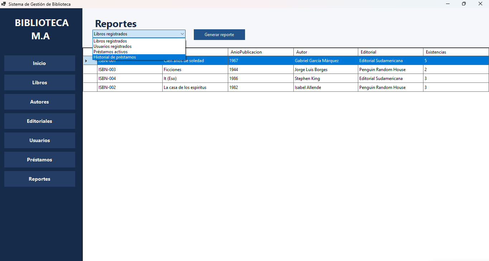

# DOCUMENTO TÉCNICO
# SISTEMA DE GESTIÓN DE BIBLIOTECA

---

## PORTADA

**ACA – PROGRAMACIÓN AVANZADA**

# SISTEMA DE GESTIÓN DE BIBLIOTECA

**Proyecto de aplicación de escritorio**

**Tecnologías utilizadas:** C#, Windows Forms y SQL Server.

**Estudiante:** Manuel Andrés Africano Bautista

**Docente:** Veronica Castro    

**Universidad:** Corporacioon Unificada Nacional CUN

**Fecha de entrega:** 8 de Noviembre de 2026

---

## CONTRAPORTADA

**Sistema de Gestión de Biblioteca**

Proyecto académico desarrollado como parte de la asignatura Programación Avanzada.

El sistema permite administrar los recursos bibliográficos, autores, editoriales, usuarios, préstamos, devoluciones y reportes mediante una aplicación de escritorio conectada a una base de datos relacional.

**Tecnologías:** C#, Windows Forms y Microsoft SQL Server.

---

## TABLA DE CONTENIDO

1. Introducción
2. Objetivo general
3. Objetivos específicos
4. Planteamiento del problema
5. Análisis de requerimientos
6. Casos de uso
7. Diagrama de clases
8. Modelo entidad-relación
9. Diccionario de datos
10. Arquitectura del sistema
11. Explicación de módulos
12. Evidencias de funcionamiento
13. Conexión con SQL Server
14. Pruebas de funcionamiento
15. Conclusiones
16. Recomendaciones
17. Referencias

---

## 1. Introducción

El sistema de gestión de biblioteca busca centralizar el registro y consulta de libros, autores, editoriales y usuarios, además del control de préstamos, devoluciones y reportes.

La solución utiliza una aplicación de escritorio desarrollada en C# mediante Windows Forms, conectada a una base de datos relacional en SQL Server.

El proyecto permite aplicar los conocimientos adquiridos en programación avanzada, programación orientada a objetos y administración de bases de datos.

## 2. Objetivo general

Desarrollar una aplicación de escritorio para gestionar la información de una biblioteca mediante C#, Windows Forms y SQL Server, aplicando principios de programación orientada a objetos y persistencia relacional.

## 3. Objetivos específicos

- Implementar operaciones de creación, consulta, actualización y eliminación de registros.
- Diseñar tablas relacionadas mediante claves primarias y foráneas.
- Gestionar préstamos y devoluciones de libros.
- Validar datos y manejar excepciones.
- Separar la presentación, la lógica de negocio y el acceso a datos.
- Facilitar la consulta de información mediante reportes.

## 4. Planteamiento del problema

La administración manual o desorganizada de libros, usuarios y préstamos dificulta la consulta de información y el seguimiento de las devoluciones.

Por esta razón, se requiere una herramienta que permita centralizar los registros, facilitar las operaciones de administración y mantener la integridad de la información.

El sistema de gestión de biblioteca ofrece una solución mediante una aplicación de escritorio conectada a una base de datos.

## 5. Análisis de requerimientos

El sistema contempla los siguientes requerimientos funcionales:

- **Gestión de libros:** registrar, consultar, actualizar y eliminar libros.
- **Gestión de autores:** administrar nombres y apellidos de los autores.
- **Gestión de editoriales:** administrar información de las editoriales.
- **Gestión de usuarios:** registrar y consultar los datos de los usuarios.
- **Gestión de préstamos:** registrar préstamos relacionando usuarios y libros.
- **Gestión de devoluciones:** actualizar el estado del préstamo y registrar la fecha de devolución.
- **Reportes:** consultar información de libros, usuarios y préstamos.

Como requerimientos no funcionales, el sistema busca ofrecer una interfaz clara, validación de información, manejo de excepciones, integridad de los datos y conexión estable con SQL Server.

## 6. Casos de uso

1. **Administrar libros:** el usuario registra, consulta, actualiza y elimina libros.
2. **Administrar autores:** registra y mantiene la información de los autores.
3. **Administrar editoriales:** registra y mantiene la información de las editoriales.
4. **Administrar usuarios:** registra y mantiene los datos de los usuarios.
5. **Registrar préstamo:** asocia un usuario y un libro con una fecha de préstamo y un estado.
6. **Registrar devolución:** actualiza el estado del préstamo y la fecha de devolución.
7. **Consultar reportes:** permite visualizar libros, usuarios, préstamos activos e historial.

## 7. Diagrama de clases

El siguiente diagrama representa la estructura principal del sistema, sus clases y las relaciones entre ellas.

## 8. Modelo entidad-relación

El siguiente diagrama representa las entidades principales de la base de datos BibliotecaAca y las relaciones entre ellas.

**Diagrama de la base de datos creado en SQL Server:**

## 9. Diccionario de datos

La base de datos BibliotecaAca está compuesta por cinco tablas relacionadas. Los campos identificadores utilizan claves primarias autoincrementales y las relaciones se establecen mediante claves foráneas.

### 9.1. Tabla: Autores

| Campo | Tipo de dato | Restricción | Descripción |
|---|---|---|---|
| IdAutor | INT | PK, IDENTITY | Identificador del autor |
| Nombre | NVARCHAR(80) | NOT NULL | Nombre del autor |
| Apellido | NVARCHAR(80) | NOT NULL | Apellido del autor |

### 9.2. Tabla: Editoriales

| Campo | Tipo de dato | Restricción | Descripción |
|---|---|---|---|
| IdEditorial | INT | PK, IDENTITY | Identificador de editorial |
| Nombre | NVARCHAR(120) | NOT NULL, UNIQUE | Nombre de la editorial |
| Ciudad | NVARCHAR(80) | NULL | Ciudad |
| Telefono | NVARCHAR(25) | NULL | Teléfono de contacto |
| Correo | NVARCHAR(120) | NULL | Correo electrónico |

### 9.3. Tabla: Usuarios

| Campo | Tipo de dato | Restricción | Descripción |
|---|---|---|---|
| IdUsuario | INT | PK, IDENTITY | Identificador del usuario |
| Nombre | NVARCHAR(80) | NOT NULL | Nombre |
| Apellido | NVARCHAR(80) | NOT NULL | Apellido |
| Documento | NVARCHAR(30) | NOT NULL, UNIQUE | Documento de identidad |
| Telefono | NVARCHAR(25) | NULL | Teléfono |
| Correo | NVARCHAR(120) | NULL | Correo electrónico |

### 9.4. Tabla: Libros

| Campo | Tipo de dato | Restricción | Descripción |
|---|---|---|---|
| IdLibro | INT | PK, IDENTITY | Identificador del libro |
| Codigo | NVARCHAR(30) | NOT NULL, UNIQUE | Código o ISBN |
| Titulo | NVARCHAR(180) | NOT NULL | Título del libro |
| AnioPublicacion | INT | NULL | Año de publicación |
| IdAutor | INT | FK, NOT NULL | Relación con Autores |
| IdEditorial | INT | FK, NOT NULL | Relación con Editoriales |
| Existencias | INT | NOT NULL, DEFAULT 1, CHECK >= 0 | Cantidad disponible registrada |

### 9.5. Tabla: Prestamos

| Campo | Tipo de dato | Restricción | Descripción |
|---|---|---|---|
| IdPrestamo | INT | PK, IDENTITY | Identificador del préstamo |
| IdUsuario | INT | FK, NOT NULL | Usuario que realiza el préstamo |
| IdLibro | INT | FK, NOT NULL | Libro prestado |
| FechaPrestamo | DATE | NOT NULL, DEFAULT GETDATE() | Fecha del préstamo |
| FechaDevolucion | DATE | NULL | Fecha de devolución |
| Estado | NVARCHAR(20) | NOT NULL, DEFAULT 'Prestado' | Estado del préstamo |

### 9.6. Relaciones entre tablas

- Autores (1) a Libros (N).
- Editoriales (1) a Libros (N).
- Usuarios (1) a Prestamos (N).
- Libros (1) a Prestamos (N).

La base de datos utiliza restricciones PRIMARY KEY, FOREIGN KEY, UNIQUE y CHECK para proteger la integridad de los registros.

## 10. Arquitectura del sistema

El sistema está organizado en tres partes principales:

- **Presentación:** implementada mediante Windows Forms, permite la interacción del usuario con los diferentes módulos.
- **Lógica de negocio:** centralizada en la clase `LibraryService`, que coordina las operaciones y reglas del sistema.
- **Acceso a datos:** gestionado mediante la clase `Database`, que permite establecer la conexión con SQL Server y ejecutar consultas parametrizadas.

SQL Server almacena las entidades y sus relaciones, garantizando la persistencia de la información.

## 11. Explicación de módulos

- **Inicio:** muestra la pantalla principal y las opciones de navegación.
- **Libros:** administra los datos bibliográficos y las referencias a autor y editorial.
- **Autores:** administra nombres y apellidos.
- **Editoriales:** administra los datos de contacto.
- **Usuarios:** administra los datos de identificación y contacto.
- **Préstamos:** relaciona usuarios y libros y permite registrar préstamos y devoluciones.
- **Reportes:** presenta listados consolidados y estados de los préstamos.

## 12. Evidencias de funcionamiento

A continuación, se presentan capturas de pantalla que muestran el funcionamiento de los principales módulos del sistema.

### 12.1. Pantalla principal

### 12.2. Módulo de libros

### 12.3. Módulo de autores

### 12.4. Módulo de editoriales

### 12.5. Módulo de usuarios

### 12.6. Módulo de préstamos

### 12.7. Módulo de reportes

## 13. Conexión con SQL Server

La cadena de conexión se configura en el archivo `appsettings.json`.

La clase `Database` crea conexiones mediante `Microsoft.Data.SqlClient`. Las operaciones de escritura utilizan parámetros SQL para ejecutar las consultas de manera segura.

La instancia utilizada durante el desarrollo fue `localhost\SQLEXPRESS` y la base de datos se denominó `BibliotecaAca`.

## 14. Pruebas de funcionamiento

Durante la revisión del sistema se realizaron las siguientes pruebas:

1. Verificar en SQL Server que la base de datos BibliotecaAca y sus cinco tablas estén creadas correctamente.
2. Abrir la aplicación y consultar los datos iniciales.
3. Registrar un autor y comprobar que aparezca en la tabla.
4. Registrar un usuario y un libro con identificadores existentes.
5. Registrar un préstamo y verificar su estado.
6. Registrar la devolución de un préstamo y comprobar la actualización de su estado.
7. Verificar la actualización de las existencias de los libros al prestar y devolver.
8. Consultar los reportes disponibles.

## 15. Conclusiones

El proyecto integra una interfaz de escritorio con una base de datos relacional para organizar los procesos básicos de una biblioteca.

La separación entre formularios, servicios y acceso a datos facilita el mantenimiento y la organización del código.

Además, las relaciones entre tablas, las restricciones de integridad y las validaciones permiten conservar la consistencia de la información durante las operaciones del sistema.

## 16. Recomendaciones

- Configurar la cadena de conexión según la instancia de SQL Server instalada.
- Realizar pruebas adicionales con diferentes escenarios.
- Mantener copias de seguridad de la base de datos.
- Registrar el desarrollo y sus cambios mediante commits en Git.
- Mantener organizada la documentación y las evidencias del proyecto.

## 17. Referencias

- Microsoft. (s. f.). *Windows Forms para .NET*. https://learn.microsoft.com/dotnet/desktop/winforms/
- Microsoft. (s. f.). *ADO.NET y SQL Server*. https://learn.microsoft.com/dotnet/framework/data/adonet/
- Microsoft. (s. f.). *Documentación de SQL Server*. https://learn.microsoft.com/sql/sql-server/